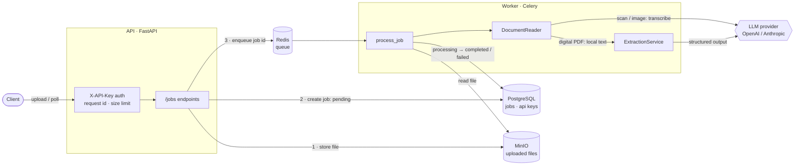
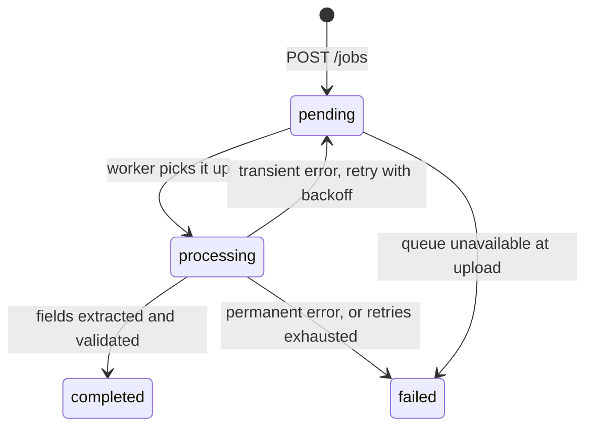

# Docs Extraction API

Upload a PDF or a photo of an **invoice**, **contract**, or **resume** and get back validated, structured JSON.

Processing is asynchronous: the upload returns a job right away, a background worker reads the document (falling back to a vision model for scans and photos), an LLM extracts the fields through native structured output, and Pydantic validates them before they are stored.

```bash
curl -H "X-API-Key: $KEY" -F file=@invoice.pdf -F document_type=invoice localhost:8000/jobs
# → 202 {"id": "…", "status": "pending", …}

curl -H "X-API-Key: $KEY" localhost:8000/jobs/<id>
# → {"status": "completed", "result": {"issuer_name": "ACME Ltda", "total_amount": 1000.0, …}}
```

**Stack:** Python 3.12 · FastAPI · Pydantic v2 · SQLAlchemy 2 + Alembic · PostgreSQL · Celery + Redis · MinIO · LangChain (OpenAI or Anthropic) · structlog · pytest · Ruff · Docker Compose · GitHub Actions

## Architecture



### Job lifecycle



| Error | Examples | Outcome |
|---|---|---|
| Permanent | corrupted or encrypted PDF, empty transcription, output not matching the schema | `failed` immediately, with a clear `error_message` |
| Transient | LLM timeout, rate limit, 5xx, storage outage | back to `pending`, retried with exponential backoff and jitter (10 s, 20 s, 40 s), then `failed` |
| Unexpected | bugs, misconfiguration | `failed` with a generic message; full traceback in the logs |

## Running it

### Everything with Docker (one command)

```bash
cp .env.example .env          # then set LLM_API_KEY (and LLM_PROVIDER / LLM_MODEL if needed)
docker compose up --build
```

This starts PostgreSQL, Redis, MinIO, a one-shot bucket setup, a one-shot migration, the API on **http://localhost:8000** (interactive docs at `/docs`), and the worker.

Create an API key (it is printed once; only its hash is stored):

```bash
docker compose exec api python -m scripts.create_api_key --name my-client
export KEY=dex_...
```

### Local development

```bash
uv sync
docker compose up -d postgres redis minio minio-setup     # infrastructure only
uv run alembic upgrade head
uv run python -m scripts.create_api_key --name dev

uv run uvicorn app.main:app --reload                                        # API
uv run celery -A app.workers.celery_app worker --pool=solo --loglevel=INFO  # worker
```

Try the extraction on a real document without the API or queue:

```bash
uv run python -m scripts.extract_file path/to/resume.pdf --type resume
```

### Quality checks

```bash
uv run pytest --cov            # needs the PostgreSQL container; uses a separate *_test database
uv run ruff check . && uv run ruff format --check .
```

CI (GitHub Actions) runs the linter, applies the migrations and runs `alembic check`, runs the tests with a 95% coverage floor, and builds the Docker image.

## API

All `/jobs` endpoints require an `X-API-Key` header, and each key only sees its own jobs. Responses carry an `X-Request-ID` header; send your own to correlate logs across services.

| Method | Path | Description |
|---|---|---|
| `GET` | `/health` | Liveness probe (public) |
| `POST` | `/jobs` | Upload a file (`multipart/form-data`: `file`, `document_type` = `invoice` \| `contract` \| `resume`) |
| `GET` | `/jobs` | List your jobs, newest first: `?status=completed&limit=20&offset=0` |
| `GET` | `/jobs/{id}` | Job status and, once completed, the extracted `result` |
| `GET` | `/jobs/{id}/file` | Download the original upload |

### Examples

```bash
# Upload (PDF, PNG, JPEG or WEBP, up to 10 MB)
curl -s -H "X-API-Key: $KEY" \
  -F file=@contract.pdf -F document_type=contract \
  http://localhost:8000/jobs

# Poll until status is "completed" or "failed"
curl -s -H "X-API-Key: $KEY" http://localhost:8000/jobs/$JOB_ID

# List failed jobs
curl -s -H "X-API-Key: $KEY" "http://localhost:8000/jobs?status=failed"

# Download the original file
curl -s -OJ -H "X-API-Key: $KEY" http://localhost:8000/jobs/$JOB_ID/file
```

A completed invoice job looks like this (values are illustrative):

```json
{
  "id": "8f0c1d2e-…",
  "status": "completed",
  "document_type": "invoice",
  "original_filename": "invoice.pdf",
  "result": {
    "invoice_number": "NF-123",
    "issuer_name": "ACME Ltda",
    "issuer_tax_id": "12.345.678/0001-90",
    "issue_date": "2026-03-01",
    "currency": "BRL",
    "line_items": [
      {"description": "Consulting", "quantity": 2.0, "unit_price": 500.0, "total": 1000.0}
    ],
    "total_amount": 1000.0
  },
  "error_message": null,
  "attempts": 1,
  "created_at": "2026-11-02T21:15:48.394606Z",
  "updated_at": "2026-11-02T21:15:52.510231Z"
}
```

Errors share one envelope:

```json
{"error": {"code": "unsupported_file_type", "message": "File content does not match its '.pdf' extension.", "details": {"expected": "application/pdf", "detected": null}}}
```

## Configuration

Settings are read from environment variables or `.env` (see [`.env.example`](.env.example)). The main ones:

| Variable | Default | Purpose |
|---|---|---|
| `LLM_PROVIDER` / `LLM_MODEL` | `openai` / `gpt-6-luna` | Any chat model LangChain supports for these providers (e.g. `anthropic` / `claude-opus-5-5`) |
| `LLM_API_KEY` | — | Provider API key |
| `PROMPT_VERSION` | `v1` | Folder under `app/prompts/` to load prompts from |
| `MAX_UPLOAD_SIZE_MB` | `10` | Upload limit, enforced before the body is read |
| `PDF_MAX_PAGES` / `VISION_MAX_PAGES` | `50` / `10` | Page limits for digital PDFs and for scans sent to the vision model |
| `JOB_MAX_RETRIES` / `JOB_RETRY_BACKOFF_SECONDS` | `3` / `10` | Retry policy for transient failures |
| `LOG_FORMAT` | `console` | `json` in containers: one JSON object per line |

## Project layout

```
app/
  api/         FastAPI routes and dependencies (auth, DB session, storage, queue)
  core/        settings, error envelope, logging, ASGI middlewares
  db/          SQLAlchemy base and session
  models/      ORM models: ExtractionJob, ApiKey
  prompts/v1/  versioned system prompts (Markdown)
  schemas/     Pydantic API schemas and LLM output schemas (Invoice, Contract, Resume)
  services/    business logic: jobs, document reading, extraction, processing, storage, API keys
  workers/     Celery app and tasks
alembic/       database migrations
scripts/       create_api_key, extract_file
tests/         pytest suite (PostgreSQL-backed, LLM always mocked)
```

## Technical decisions

- **Native structured output (`method="json_schema"`)** instead of forced tool calling. Recent models (e.g. Claude Opus 5.5) reject forced `tool_choice`, and native JSON Schema output is constrained by the provider itself. Every output field is required but nullable, so the schemas also satisfy OpenAI's strict mode, and the model has to answer `null` explicitly instead of inventing values.
- **Two-step reading for scans and images:** the vision model transcribes the document to text first, then the same text extraction runs as for digital PDFs. One extraction path to test and tune. Digital PDFs never reach the vision model; they are read locally with pdfium.
- **Prompts as versioned files** (`app/prompts/v1/*.md`), selected by `PROMPT_VERSION`, so a prompt change is a reviewable diff and can be rolled back with configuration. Document text is wrapped in `<document>` tags and treated as untrusted data.
- **Job state lives in PostgreSQL, not in Celery:** there is no result backend. The task is a thin wrapper around a plain `process_job()` function, which keeps the state machine testable without a broker. Tasks are idempotent (finished jobs are skipped) and acknowledged late, so a crashed worker's job is redelivered.
- **Enqueue after commit:** the worker always finds the row. If Redis is down, the job is marked `failed` and the API returns 503 instead of leaving it pending forever.
- **Storage behind a `Storage` protocol,** with a MinIO implementation for runtime and an in-memory one for tests. Downloads are proxied through the API, which enforces ownership; pre-signed URLs would expose the internal MinIO address. MinIO stopped publishing free community images, so Compose uses Chainguard's free rebuild.
- **API keys hashed with SHA-256:** the keys are 256-bit random tokens, so a slow password hash adds nothing, and an indexed lookup by digest never compares plaintext. Another client's job returns 404 rather than 403, so its existence is not revealed.
- **Upload hardening:** the body size is checked from `Content-Length` before anything is read (chunked uploads are refused with 411), and the file's magic bytes must match its extension.
- **Observability:** structlog renders our logs, uvicorn's and Celery's through one pipeline. The request id from the upload is passed to the Celery task, so one id follows a document from the HTTP request to the end of its extraction.
- **Tests run against real PostgreSQL** (each test inside a rolled-back transaction) and never call an LLM. Real SDK exception classes are used to test retry classification.

## Limitations and next steps

- Polling only; a webhook or server-sent events on job completion would avoid it.
- A job claims no database lock while processing. Late acknowledgment plus idempotency covers redelivery, but two workers could, in rare cases, process the same job concurrently.
- No admin API for keys: they are created and revoked with the script or SQL.
- There is no evaluation suite against labeled documents yet, which would be the next step before tuning prompts or comparing models.
