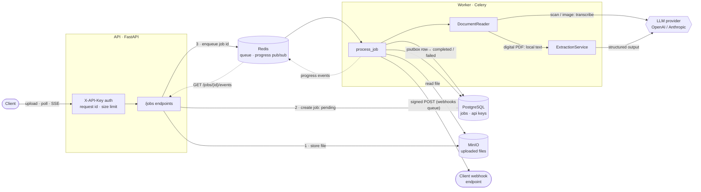
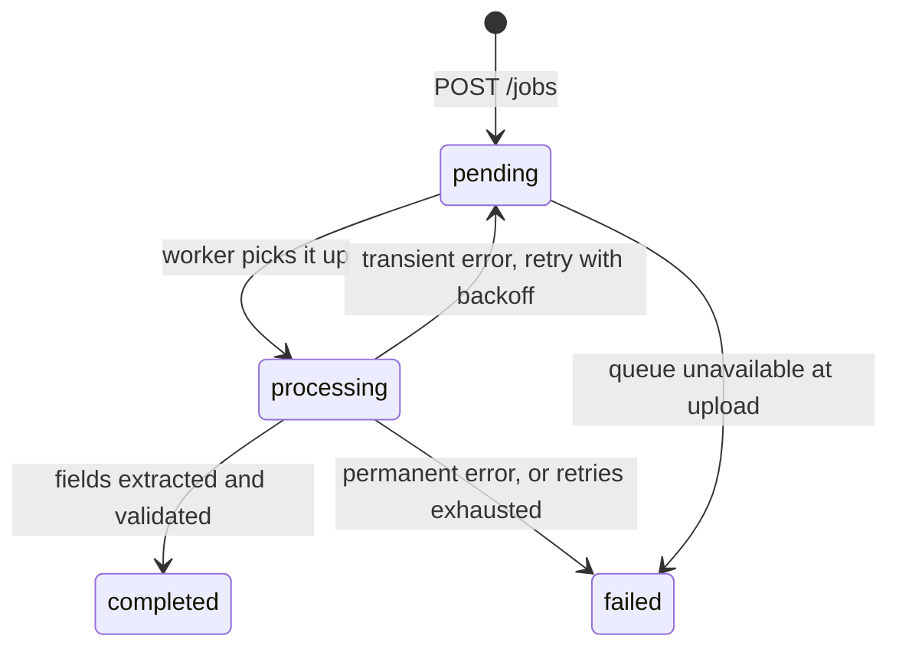

# Docs Extraction API

Upload a PDF or a photo of an **invoice**, **contract**, or **resume** and get back validated, structured JSON.

Processing is asynchronous: the upload returns a job right away, a background worker reads the document (falling back to a vision model for scans and photos), an LLM extracts the fields through native structured output, and Pydantic validates them before they are stored. Clients can poll the job or follow each step live over Server-Sent Events.

```bash
curl -H "X-API-Key: $KEY" -F file=@invoice.pdf -F document_type=invoice localhost:8000/jobs
# → 202 {"id": "…", "status": "pending", …}

curl -N -H "X-API-Key: $KEY" localhost:8000/jobs/<id>/events
# → event: queued → processing → reading → extracting → completed (with the result)
```

**Stack:** Python 3.12 · FastAPI · Pydantic v2 · SQLAlchemy 2 + Alembic · PostgreSQL · Celery + Redis · MinIO · LangChain (OpenAI or Anthropic) · structlog · pytest · Ruff · Docker Compose · GitHub Actions

## Architecture



### Job lifecycle



| Error | Examples | Outcome |
|---|---|---|
| Permanent | corrupted or encrypted PDF, empty transcription, output not matching the schema | `failed` immediately, with a clear `error_message` |
| Transient | LLM timeout, rate limit, 5xx, storage outage | back to `pending`, retried with exponential backoff and jitter (10 s, 20 s, 40 s), then `failed` |
| Unexpected | bugs, misconfiguration | `failed` with a generic message; full traceback in the logs |

## Running it

### Everything with Docker (one command)

```bash
cp .env.example .env          # then set LLM_API_KEY (and LLM_PROVIDER / LLM_MODEL if needed)
docker compose up --build
```

This starts PostgreSQL, Redis, MinIO, a one-shot bucket setup, a one-shot migration, the API on **http://localhost:8000** (web UI at `/ui/`, interactive docs at `/docs`), and the worker.

Create an API key (it is printed once; only its hash is stored):

```bash
docker compose exec api python -m scripts.create_api_key --name my-client
export KEY=dex_...
```

### Web UI

Open **http://localhost:8000/ui/**, paste your API key, and drop a document. The page shows a live "routing slip" of the processing steps as they happen, then the extracted JSON (copyable) and a download of the original file; recent jobs can be reopened from the list, even while they are still running.

It is plain HTML, CSS and JavaScript in [`app/web/`](app/web/), served by FastAPI on the same origin (no build step, no CORS). The key is kept in `sessionStorage`, and the event stream is read with `fetch`, because the browser's `EventSource` cannot send the `X-API-Key` header. Dropped connections reconnect with backoff, which is safe because every stream starts from the job's current state.

### Local development

```bash
uv sync
docker compose up -d postgres redis minio minio-setup     # infrastructure only
uv run alembic upgrade head
uv run python -m scripts.create_api_key --name dev

uv run uvicorn app.main:app --reload                                        # API
uv run celery -A app.workers.celery_app worker --pool=solo --loglevel=INFO \
  --queues=celery,webhooks --beat --schedule=/tmp/celerybeat-schedule        # worker
```

Try the extraction on a real document without the API or queue:

```bash
uv run python -m scripts.extract_file path/to/resume.pdf --type resume
```

### Quality checks

```bash
uv run pytest --cov            # needs the PostgreSQL container; uses a separate *_test database
uv run ruff check . && uv run ruff format --check .
```

CI (GitHub Actions) runs the linter, applies the migrations and runs `alembic check`, runs the tests with a 95% coverage floor, and builds the Docker image.

## API

All `/jobs` endpoints require an `X-API-Key` header, and each key only sees its own jobs. Responses carry an `X-Request-ID` header; send your own to correlate logs across services.

| Method | Path | Description |
|---|---|---|
| `GET` | `/health` | Liveness probe (public) |
| `POST` | `/jobs` | Upload a file (`multipart/form-data`: `file`, `document_type` = `invoice` \| `contract` \| `resume`) |
| `GET` | `/jobs` | List your jobs, newest first: `?status=completed&limit=20&offset=0` |
| `GET` | `/jobs/{id}` | Job status and, once completed, the extracted `result` |
| `GET` | `/jobs/{id}/events` | Live progress as Server-Sent Events, until the job completes or fails |
| `PUT` | `/webhook` | Register or change your webhook URL (`{"url": "https://…"}`); returns the signing secret |
| `GET` | `/webhook` | Your webhook URL and signing secret |
| `DELETE` | `/webhook` | Stop notifications |
| `GET` | `/webhook/deliveries` | Recent notifications and their delivery status |
| `GET` | `/jobs/{id}/file` | Download the original upload |

### Examples

```bash
# Upload (PDF, PNG, JPEG or WEBP, up to 10 MB)
curl -s -H "X-API-Key: $KEY" \
  -F file=@contract.pdf -F document_type=contract \
  http://localhost:8000/jobs

# Poll until status is "completed" or "failed"
curl -s -H "X-API-Key: $KEY" http://localhost:8000/jobs/$JOB_ID

# Or follow it live (Server-Sent Events; the stream ends with the final event)
curl -s -N -H "X-API-Key: $KEY" http://localhost:8000/jobs/$JOB_ID/events

# List failed jobs
curl -s -H "X-API-Key: $KEY" "http://localhost:8000/jobs?status=failed"

# Download the original file
curl -s -OJ -H "X-API-Key: $KEY" http://localhost:8000/jobs/$JOB_ID/file
```

A completed invoice job looks like this (values are illustrative):

```json
{
  "id": "8f0c1d2e-…",
  "status": "completed",
  "document_type": "invoice",
  "original_filename": "invoice.pdf",
  "result": {
    "invoice_number": "NF-123",
    "issuer_name": "ACME Ltda",
    "issuer_tax_id": "12.345.678/0001-90",
    "issue_date": "2026-03-01",
    "currency": "BRL",
    "line_items": [
      {"description": "Consulting", "quantity": 2.0, "unit_price": 500.0, "total": 1000.0}
    ],
    "total_amount": 1000.0
  },
  "error_message": null,
  "attempts": 1,
  "created_at": "2026-11-02T21:15:48.394606Z",
  "updated_at": "2026-11-02T21:15:52.510231Z"
}
```

### Live progress (Server-Sent Events)

`GET /jobs/{id}/events` returns `text/event-stream`. The first event is always the job's current state, so connecting late, or reconnecting, is safe; then each step is pushed as it happens, and the stream closes after `completed` or `failed`, whose `job` field carries the full result:

```
event: queued
data: {"stage":"queued","status":"pending","attempt":0,"message":null,"at":"…","job":null}
id: 1

event: processing
data: {"stage":"processing","status":"processing","attempt":1, …}
id: 2

event: reading        (then "transcribing" for scans and images)
event: extracting
event: completed
data: {"stage":"completed","status":"completed", …, "job":{…, "result":{…}}}
id: 5
```

Other stages: `retrying` (a transient failure; `message` says why) and `failed`. Idle connections get a `: ping` comment every 15 s. Browsers' `EventSource` cannot send the `X-API-Key` header, so web clients should read the stream with `fetch` instead.

### Webhooks

Register a URL once per API key and the API will `POST` to it whenever one of that key's jobs finishes, so integrations need neither polling nor an open connection:

```bash
curl -s -X PUT -H "X-API-Key: $KEY" -H "Content-Type: application/json" \
  -d '{"url": "https://example.com/hooks/docs-extraction"}' http://localhost:8000/webhook
# → {"url": "https://example.com/hooks/docs-extraction", "secret": "whsec_…", "events": ["job.completed", "job.failed"]}
```

Each notification is a JSON body with the full job (including `result` or `error_message`) and these headers:

| Header | Meaning |
|---|---|
| `X-Webhook-Event` | `job.completed` or `job.failed` |
| `X-Webhook-Id` | Delivery id, identical on every retry: use it to ignore duplicates |
| `X-Webhook-Signature` | `t=<unix time>,v1=<hex HMAC-SHA256 of "<t>.<raw body>" with your secret>` |

```json
{"id": "dd04a3de-…", "type": "job.completed", "created_at": "…", "data": {"job": {"id": "…", "status": "completed", "result": {…}, …}}}
```

Verify the signature on the raw body before trusting it, and reject old timestamps to block replays:

```python
import hashlib, hmac, time


def verify(secret: str, header: str, body: bytes, tolerance: int = 300) -> bool:
    fields = dict(part.split("=", 1) for part in header.split(","))
    timestamp = int(fields["t"])
    expected = hmac.new(
        secret.encode(), f"{timestamp}.".encode() + body, hashlib.sha256
    ).hexdigest()
    return abs(time.time() - timestamp) <= tolerance and hmac.compare_digest(expected, fields["v1"])
```

Answer with any `2xx` to acknowledge. Timeouts, connection errors, `408`, `429` and `5xx` are retried with exponential backoff (30 s, 60 s, 120 s, … up to 5 retries); other `4xx` and redirects (never followed) fail the delivery at once. `GET /webhook/deliveries` shows each delivery's status, attempts and last error.

The URL must use HTTPS and resolve to a public address, checked on registration and again before every delivery. For local development against a receiver on your machine, set `WEBHOOK_ALLOW_INSECURE_URLS=true` (allows `http://` and private hosts such as `host.docker.internal`); never enable it in production.

Errors share one envelope:

```json
{"error": {"code": "unsupported_file_type", "message": "File content does not match its '.pdf' extension.", "details": {"expected": "application/pdf", "detected": null}}}
```

## Configuration

Settings are read from environment variables or `.env` (see [`.env.example`](.env.example)). The main ones:

| Variable | Default | Purpose |
|---|---|---|
| `LLM_PROVIDER` / `LLM_MODEL` | `openai` / `gpt-6-luna` | Any chat model LangChain supports for these providers (e.g. `anthropic` / `claude-opus-5-5`) |
| `LLM_API_KEY` | — | Provider API key |
| `PROMPT_VERSION` | `v2` | Folder under `app/prompts/` to load prompts from |
| `MAX_UPLOAD_SIZE_MB` | `10` | Upload limit, enforced before the body is read |
| `PDF_MAX_PAGES` / `VISION_MAX_PAGES` | `50` / `10` | Page limits for digital PDFs and for scans sent to the vision model |
| `JOB_MAX_RETRIES` / `JOB_RETRY_BACKOFF_SECONDS` | `3` / `10` | Retry policy for transient failures |
| `LOG_FORMAT` | `console` | `json` in containers: one JSON object per line |

## Project layout

```
app/
  api/         FastAPI routes and dependencies (auth, DB session, storage, queue, events)
  core/        settings, error envelope, logging, ASGI middlewares
  db/          SQLAlchemy base and session
  models/      ORM models: ExtractionJob, ApiKey
  prompts/     versioned system prompts (Markdown), one folder per version
  schemas/     Pydantic API schemas and LLM output schemas (Invoice, Contract, Resume)
  web/         the web UI (static HTML, CSS and JavaScript)
  services/    business logic: jobs, document reading, extraction, processing, progress
               events, webhooks, storage, API keys
  workers/     Celery app and tasks
alembic/       database migrations
scripts/       create_api_key, extract_file
tests/         pytest suite (PostgreSQL-backed, LLM always mocked)
```

## Technical decisions

- **Native structured output (`method="json_schema"`)** instead of forced tool calling. Recent models (e.g. Claude Opus 5.5) reject forced `tool_choice`, and native JSON Schema output is constrained by the provider itself. Every output field is required but nullable, so the schemas also satisfy OpenAI's strict mode, and the model has to answer `null` explicitly instead of inventing values.
- **Two-step reading for scans and images:** the vision model transcribes the document to text first, then the same text extraction runs as for digital PDFs. One extraction path to test and tune. Digital PDFs never reach the vision model; they are read locally with pdfium.
- **Prompts as versioned files** (`app/prompts/v2/*.md`), selected by `PROMPT_VERSION`, so a prompt change is a reviewable diff and can be rolled back with configuration. Document text is wrapped in `<document>` tags and treated as untrusted data.
- **Job state lives in PostgreSQL, not in Celery:** there is no result backend. The task is a thin wrapper around a plain `process_job()` function, which keeps the state machine testable without a broker. Tasks are idempotent (finished jobs are skipped) and acknowledged late, so a crashed worker's job is redelivered.
- **Enqueue after commit:** the worker always finds the row. If Redis is down, the job is marked `failed` and the API returns 503 instead of leaving it pending forever.
- **Storage behind a `Storage` protocol,** with a MinIO implementation for runtime and an in-memory one for tests. Downloads are proxied through the API, which enforces ownership; pre-signed URLs would expose the internal MinIO address. MinIO stopped publishing free community images, so Compose uses Chainguard's free rebuild.
- **API keys hashed with SHA-256:** the keys are 256-bit random tokens, so a slow password hash adds nothing, and an indexed lookup by digest never compares plaintext. Another client's job returns 404 rather than 403, so its existence is not revealed.
- **Upload hardening:** the body size is checked from `Content-Length` before anything is read (chunked uploads are refused with 411), and the file's magic bytes must match its extension.
- **Observability:** structlog renders our logs, uvicorn's and Celery's through one pipeline. The request id from the upload is passed to the Celery task, so one id follows a document from the HTTP request to the end of its extraction.
- **Live progress over Redis pub/sub + SSE:** the worker publishes each step on a per-job channel, and `GET /jobs/{id}/events` relays it using FastAPI's native SSE support. Pub/sub drops messages nobody is listening to, so the endpoint subscribes first, then sends a snapshot from PostgreSQL, which keeps the database the source of truth and makes reconnecting safe. If no event arrives for 30 s, it re-reads the database, so a lost final event cannot leave a stream open forever. Publishing is best effort and can never fail a job.
- **Webhooks with a transactional outbox:** the delivery row is written in the same transaction that finishes the job, so a notification cannot be lost between "job done" and "webhook sent". Deliveries run on their own Celery queue (a slow receiver never delays extractions), are at-least-once with a stable `X-Webhook-Id`, and are signed with HMAC-SHA256 plus a timestamp. A periodic sweep (Celery beat, embedded in the worker) re-enqueues deliveries whose task was lost.
- **SSRF protection for client-supplied URLs:** HTTPS only, no credentials, and every resolved address must be public (private, loopback, link-local, metadata and IPv4-mapped ranges are refused). The check runs on registration and again before each delivery, since DNS can change, and redirects are not followed.
- **Tests run against real PostgreSQL** (each test inside a rolled-back transaction) and never call an LLM. Real SDK exception classes are used to test retry classification.

## Limitations and next steps

- The webhook destination check resolves DNS and then connects separately, so a hostile DNS server could still swap the address in between (DNS rebinding). Pinning the connection to the checked IP, or sending through an egress proxy, would close that gap.
- One webhook URL per API key, and no manual redelivery endpoint yet.
- A job claims no database lock while processing. Late acknowledgment plus idempotency covers redelivery, but two workers could, in rare cases, process the same job concurrently.
- No admin API for keys: they are created and revoked with the script or SQL.
- There is no evaluation suite against labeled documents yet, which would be the next step before tuning prompts or comparing models.
